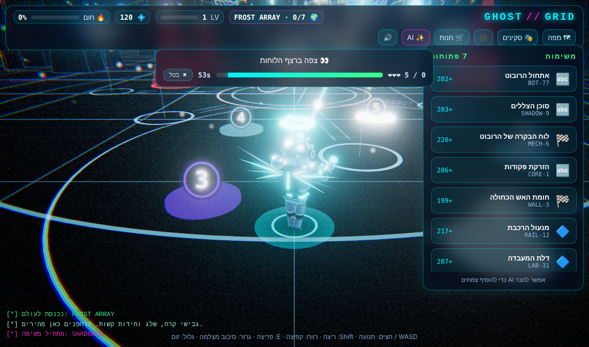
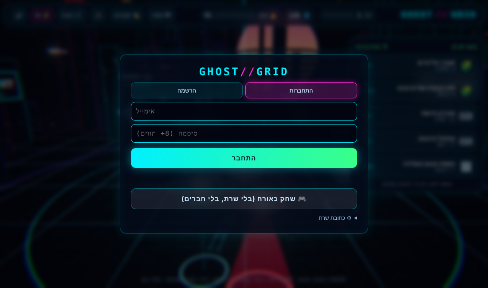
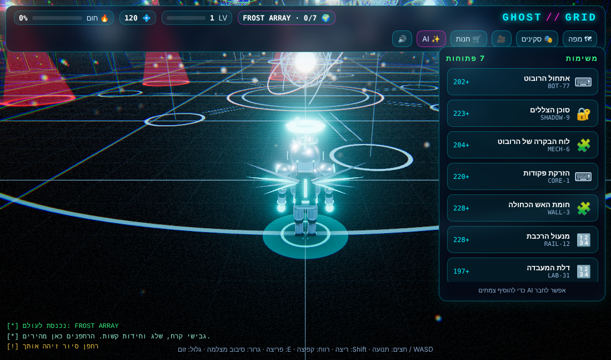

# GHOST//GRID 🕶

משחק תלת-ממדי על עולמות שגוועים. אתה והחברים שלך רצים בעולם, מתקנים אותו בעצמכם (אין חלונות שאלות, הכול קורה בתוך העולם) ומצילים אותו. הכול מומצא, לא פורצים שום דבר באמת.


## איך משחקים
1. **מתחברים** עם אימייל וסיסמה (בהרשמה בוחרים שם משתמש), או נכנסים כאורח לבד.
2. **בוחרים עולם במפה:** לוחצים על כוכב והמצלמה עפה לתוכו. עולם נפתח אחרי שמסיימים את הקודם.
3. **מתקנים את העולם:** בכל עולם יש צמתים תקולים. ניגשים לצומת, לוחצים E ומבצעים משימה בתלת-ממד:
   - **ממסר לוחות 🔷** – צופים בלוחות שנדלקים ואז דורכים עליהם באותו סדר.
   - **פענוח אותיות 🔤** – עוברים דרך אותיות צפות לפי הסדר כדי לאיית מילה. אות שגויה פוגעת בך.
   - **ספרינט שערים 🏁** – רצים (Shift) דרך שערים מוארים לפי המספרים לפני שהזמן נגמר.
4. **רחפני סיור 🚨** מסיירים ומעלים את החום. חום 100% = נעילה. פחות חום בסוף העולם = יותר כוכבים.
5. **הבוס 👑** בעולם האחרון: שלושת האתגרים ברצף, טעות אחת מתחילה אותו מחדש.

| | |
|---|---|
|  |  |
|  |  |

## 6 עולמות
| עולם | אווירה |
|---|---|
| רובע הניאון | העיר שבה הכול מתחיל |
| מפעל הארגמן | גחלים באוויר, 2 רחפנים |
| ביצת הרעל | ערפל ירוק וספורות זוהרות |
| מערך הקרח | שלג, גבישים ורחפנים מהירים |
| מצודת הריק | גשם סגול ואובליסקים |
| ליבת השמש | 5 רחפנים ובוס |





## קושי לפי מספר שחקנים בחדר
חדר פרטי (רק עם קוד) או ציבורי (מופיע ברשימה), עד 15 שחקנים. ככל שיש יותר שחקנים, יש יותר רחפנים, הם מהירים יותר, הזמן קצר יותר והחום עולה מהר יותר.

| שחקנים בחדר | קושי |
|---|---|
| לבד עד 3 | קל |
| 4 | בינוני |
| 5 עד 7 | קשה |
| 8 עד 15 | קשה מאוד |

פריצת צומת על ידי שחקן אחד נספרת לכל החדר. המארח בוחר את העולם לכולם.

## חשבונות וניהול
- הרשמה: אימייל, שם משתמש (ייחודי) וסיסמה. התחברות עם אימייל או שם משתמש. Google אופציונלי ומופעל רק אם מגדירים `GOOGLE_CLIENT_ID`.
- **בעלים ומנהלים.** מנהל יכול להוסיף מנהלים לפי אימייל:
  - אם המשתמש כבר רשום, הוא הופך למנהל.
  - אם עדיין לא, ברגע שיירשם עם האימייל הזה הוא יהפוך אוטומטית למנהל.
  - אפשר גם ליצור לו חשבון מיד עם סיסמה.
- מנהל יכול להסיר מנהל, לחסום, לאפס סיסמה, לשנות הגדרות ולסגור חדרים. הבעלים יכול להעביר בעלות.
- **AI למנהלים בלי מפתח:** מוגדר פעם אחת בשרת (`ANTHROPIC_API_KEY`). מוסיף צמתים בנושא שתבחר.

## הרצה מקומית
```bash
npm run install:all
npm run build
OWNER_EMAIL=you@example.com OWNER_PASSWORD='סיסמה-ארוכה' npm start
# פתח http://localhost:3000
```
בדיקות שרת: `npm test`.

## העלאה לאינטרנט (חובה כדי לשחק עם חברים)
השרת חייב לרוץ במקום שכולם מגיעים אליו. הכי פשוט: [Render](https://render.com) → New → Blueprint → בחר את הריפו (יש `render.yaml` ו-`Dockerfile`).
הגדר בדשבורד את המשתנים מ-`.env.example`: `OWNER_EMAIL`, `OWNER_PASSWORD`, ואופציונלי `ANTHROPIC_API_KEY`, `GOOGLE_CLIENT_ID`.
> בתוכנית החינמית של Render אין דיסק קבוע, ולכן חשבונות עלולים להימחק כשהשרת נרדם ומתאפס. לשימוש רציני הוסף דיסק קבוע (`DATA_DIR`) או תוכנית בתשלום.

## EXE ו-APK
ב-GitHub: לשונית **Actions → Build EXE + APK → Run workflow**. בסיום יורדים מה-Artifacts:
- `GHOST-GRID-windows` – קובץ EXE (portable + מתקין).
- `GHOST-GRID-android` – קובץ APK (debug, להתקנה ידנית).

באפליקציה, במסך ההתחברות פתח **⚙ כתובת שרת** והדבק את כתובת השרת שלך (https://...). התחברות Google עובדת בדפדפן; באפליקציות השתמש באימייל וסיסמה.

## אבטחה
- סיסמאות נשמרות עם scrypt. לעולם אל תעלה `.env` ל-GitHub.
- הריפו ציבורי: אל תכניס אליו סיסמאות או מפתחות.
