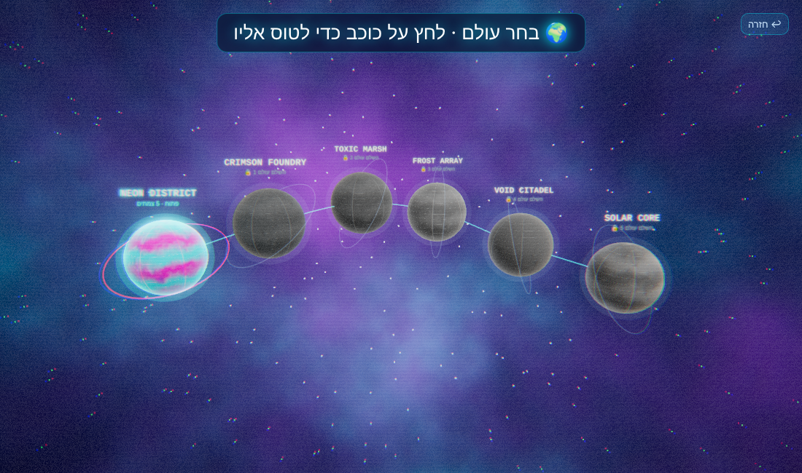
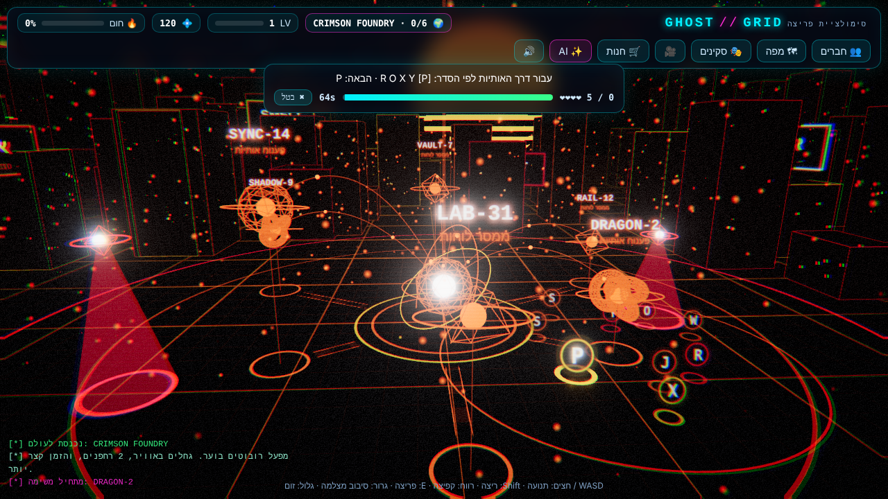
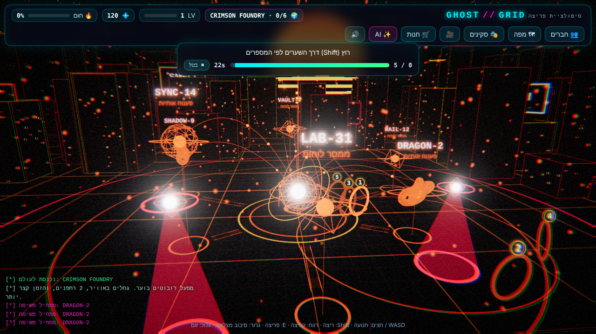
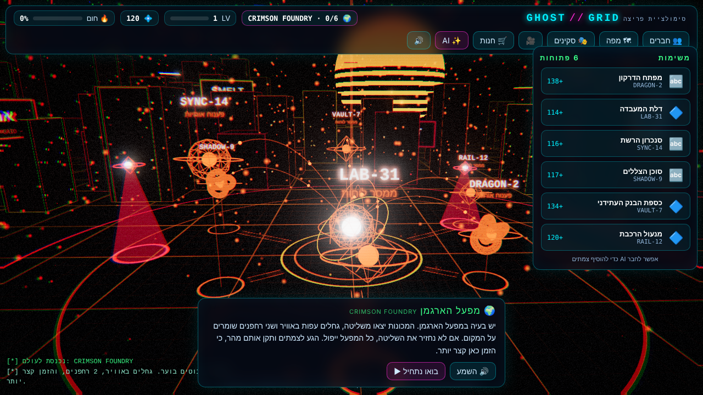
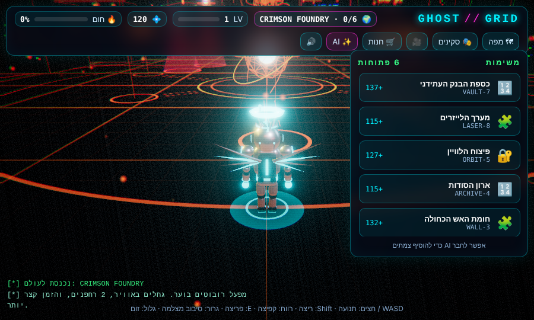
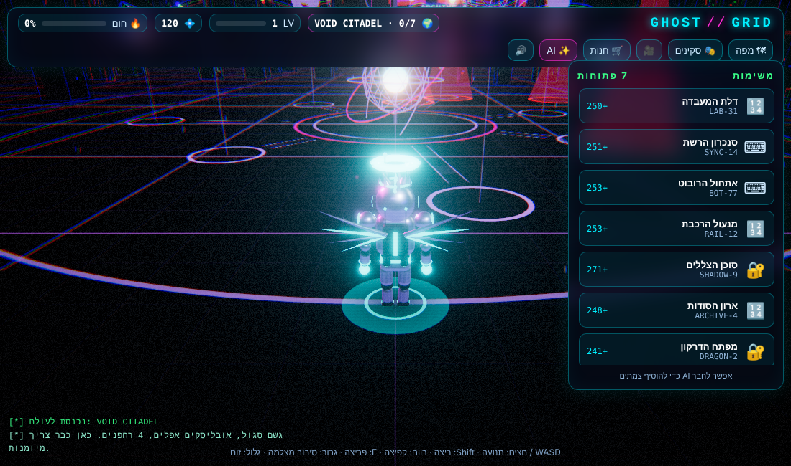

# GHOST//GRID 🕶

משחק תלת-ממדי על עולמות שגוועים. אתה והחברים שלך רצים בעולם, מתקנים אותו בעצמכם (אין חלונות שאלות, הכול קורה בתוך העולם) ומצילים אותו. הכול מומצא, לא פורצים שום דבר באמת.



## איך משחקים
1. **נכנסים:** כותבים שם ולוחצים **שחק**. מי שמפעיל שרת יכול גם להתחבר עם אימייל וסיסמה (בהרשמה בוחרים שם משתמש).
2. **בוחרים עולם במפה:** לוחצים על כוכב והמצלמה עפה לתוכו. עולם נפתח אחרי שמסיימים את הקודם.
3. **הודעת פתיחה:** בכניסה לעולם מופיע בעברית סיפור קצר על הבעיה בעולם ומה צריך לעשות. כפתור **🔊 השמע** מקריא אותו בקול (דורש קול בעברית במכשיר), ו-**בואו נתחיל** סוגר אותו.
4. **מתקנים את העולם:** בכל עולם יש צמתים תקולים. ניגשים לצומת, לוחצים E ומבצעים משימה בתלת-ממד:
   - **ממסר לוחות 🔷** – צופים בלוחות שנדלקים ואז דורכים עליהם באותו סדר.
   - **פענוח אותיות 🔤** – עוברים דרך אותיות צפות לפי הסדר כדי לאיית מילה. המילה מוצגת בראש המסך והאות הבאה מסומנת ומוגדלת. אות שגויה פוגעת בך.
   - **ספרינט שערים 🏁** – רצים (Shift) דרך שערים מוארים לפי המספרים לפני שהזמן נגמר.
5. **רחפני סיור 🚨** מסיירים ומעלים את החום. חום 100% = נעילה. פחות חום בסוף העולם = יותר כוכבים.
6. **הבוס 👑** בעולם האחרון: שלושת האתגרים ברצף, טעות אחת מתחילה אותו מחדש.

| | |
|---|---|
|  |  |
|  |  |


## טלפון
המשחק מותאם גם למסך קטן, גם לאורך וגם לרוחב: סרגל עליון דק, ג'ויסטיק וכפתור קפיצה, והפאנלים קטנים יותר.

## 6 עולמות
| עולם | אווירה |
|---|---|
| רובע הניאון | העיר שבה הכול מתחיל |
| מפעל הארגמן | גחלים באוויר, 2 רחפנים |
| ביצת הרעל | ערפל ירוק וספורות זוהרות |
| מערך הקרח | שלג, גבישים ורחפנים מהירים |
| מצודת הריק | גשם סגול ואובליסקים |
| ליבת השמש | 5 רחפנים ובוס |





## קושי לפי מספר שחקנים בחדר
חדר פרטי (רק עם קוד) או ציבורי (מופיע ברשימה), עד 15 שחקנים. ככל שיש יותר שחקנים, יש יותר רחפנים, הם מהירים יותר, הזמן קצר יותר והחום עולה מהר יותר.

| שחקנים בחדר | קושי |
|---|---|
| לבד עד 3 | קל |
| 4 | בינוני |
| 5 עד 7 | קשה |
| 8 עד 15 | קשה מאוד |

פריצת צומת על ידי שחקן אחד נספרת לכל החדר. המארח בוחר את העולם לכולם.

## חשבונות וניהול
- הרשמה: אימייל, שם משתמש (ייחודי) וסיסמה. התחברות עם אימייל או שם משתמש. Google אופציונלי ומופעל רק אם מגדירים `GOOGLE_CLIENT_ID`.
- **בעלים ומנהלים.** מנהל יכול להוסיף מנהלים לפי אימייל:
  - אם המשתמש כבר רשום, הוא הופך למנהל.
  - אם עדיין לא, ברגע שיירשם עם האימייל הזה הוא יהפוך אוטומטית למנהל.
  - אפשר גם ליצור לו חשבון מיד עם סיסמה.
- מנהל יכול להסיר מנהל, לחסום, לאפס סיסמה, לשנות הגדרות ולסגור חדרים. הבעלים יכול להעביר בעלות.
- **AI למנהלים בלי מפתח:** מוגדר פעם אחת בשרת (`ANTHROPIC_API_KEY`). מוסיף צמתים בנושא שתבחר.

## הרצה מקומית
```bash
npm run install:all
npm run build
OWNER_EMAIL=you@example.com OWNER_PASSWORD='סיסמה-ארוכה' npm start
# פתח http://localhost:3000
```
בדיקות שרת: `npm test`.

## לשחק עם חברים בלי שרת
לא צריך שרת ולא חשבון. כל אחד נכנס, כותב שם ולוחץ **"שחק עם חברים"**:
1. אחד לוחץ **צור חדר** ומקבל קוד בן 5 תווים.
2. החברים לוחצים **הצטרף** ומקלידים את הקוד.

החדר רץ ישירות בין הדפדפנים/אפליקציות (WebRTC דרך PeerJS), עד 15 שחקנים. הקושי עולה אוטומטית לפי מספר השחקנים.
מגבלות: החדר קיים רק כל עוד היוצר נשאר במשחק; אין חשבונות, מנהלים או רשימת חדרים ציבורית; ו-AI לבני אדם דורש שרת. במצב הזה נעזרים בשירות החיבור החינמי של PeerJS, ובמקרים נדירים (רשתות סלולר מחמירות) החיבור עלול להיכשל.

## שרת (אופציונלי: חשבונות, מנהלים, AI, חדרים ציבוריים)
> לא חובה. אם רק רוצים לשחק עם חברים, מספיק החדרים שלמעלה.
[](https://render.com/deploy?repo=https://github.com/Daniel2025992/Ghost-grid)

לחץ על הכפתור, התחבר ל-Render עם GitHub, ומלא את שני השדות `OWNER_EMAIL` ו-`OWNER_PASSWORD` (חובה). את `ANTHROPIC_API_KEY` ו-`GOOGLE_CLIENT_ID` מוסיפים אחר כך בדשבורד של Render, בלשונית Environment. אחרי כמה דקות תקבל כתובת (https://...onrender.com). את הכתובת הזו מכניסים ל-GitHub: Settings → Secrets and variables → Actions → Variables → משתנה בשם `GG_SERVER`, ואז מריצים שוב את הבנייה, וה-EXE וה-APK יכירו את השרת לבד.

השרת חייב לרוץ במקום שכולם מגיעים אליו. הכי פשוט: [Render](https://render.com) → New → Blueprint → בחר את הריפו (יש `render.yaml` ו-`Dockerfile`).
הגדר בדשבורד את המשתנים מ-`.env.example`: `OWNER_EMAIL`, `OWNER_PASSWORD`, ואופציונלי `ANTHROPIC_API_KEY`, `GOOGLE_CLIENT_ID`.
> בתוכנית החינמית של Render אין דיסק קבוע, ולכן חשבונות עלולים להימחק כשהשרת נרדם ומתאפס. לשימוש רציני הוסף דיסק קבוע (`DATA_DIR`) או תוכנית בתשלום.

## EXE ו-APK
בונים אוטומטית עם GitHub Actions (**Actions → Build EXE + APK → Run workflow**). כל בנייה מתפרסמת כגרסה חדשה בלשונית **[Releases](../../releases)**, ומשם מורידים:
- `GHOST-GRID.apk` – אנדרואיד (גרסת debug, התקנה ידנית). כדי לעדכן, מוחקים את האפליקציה הישנה ומתקינים מחדש.
- `GHOST-GRID.Setup.x.x.x.exe` – מתקין ל-Windows. `GHOST-GRID.x.x.x.exe` – גרסה ניידת בלי התקנה.

אפשר לשחק עם חברים בלי להגדיר כלום (ראה למעלה). רק מי שמפעיל שרת מדביק את כתובתו ב-**⚙ כתובת שרת** בתפריט "יש לי שרת וחשבון" במסך הכניסה.

## אבטחה
- סיסמאות נשמרות עם scrypt. לעולם אל תעלה `.env` ל-GitHub.
- הריפו ציבורי: אל תכניס אליו סיסמאות או מפתחות.
